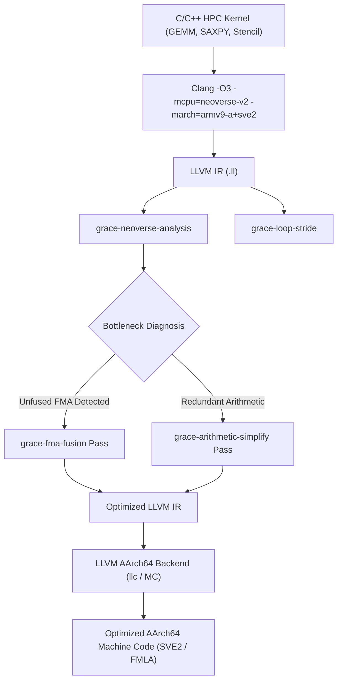

# Grace Compiler Lab

[](https://github.com/Shivampal157/grace-compiler-lab/actions/workflows/build.yml)
[](https://llvm.org/)
[-76B900.svg)](https://www.nvidia.com/en-in/data-center/grace-cpu/)
[](https://en.cppreference.com/w/cpp/17)

An out-of-tree **LLVM New Pass Manager** optimization and microarchitectural analysis framework tailored for the **NVIDIA Grace CPU** (Arm Neoverse V2 microarchitecture, ARMv9.0-A + SVE2).

This project makes CPU compiler decisions measurable, explainable, and aligned with modern data center architectures. It explores the interaction between intermediate representations (LLVM IR), execution pipeline resources (superscalar issue ports, vector pipelines), and high-bandwidth memory hierarchies (546 GB/s LPDDR5X).

> **Disclaimer**: This is an independent compiler engineering lab built against public LLVM APIs and Arm Neoverse V2 architectural specifications. It does not reproduce proprietary NVIDIA source code or internal compiler trees.

---

## Architecture Overview: NVIDIA Grace CPU & Neoverse V2

The **NVIDIA Grace CPU** packages 72 Arm Neoverse V2 cores connected via a high-bandwidth coherent mesh interconnect, coupled with 546 GB/s LPDDR5X memory and 900 GB/s bidirectional NVLink-C2C to GPUs. Optimizing compilers targeting Grace must reason about the following microarchitectural features:

```text
+-----------------------------------------------------------------------------------+
|                           Arm Neoverse V2 Core Pipeline                           |
|  16-Wide Instruction Fetch & Decode  -->  8-Wide Micro-Op Dispatch / Rename       |
+-----------------------------------------------------------------------------------+
       |                 |                 |                 |               |
       v                 v                 v                 v               v
  [Ports V0-V3]     [Ports I0-I5]     [Ports L0-L2]     [Ports S0-S1]    [Ports B0-B1]
   4x 128-bit        6x Integer        3x Load Units     2x Store Units   2x Branch
  SVE2 / NEON        ALU Units        (Up to 3/cycle)   (Up to 2/cycle)  (Up to 2/cycle)
   Vector/FMA       (Up to 6/cycle)
  (Up to 4/cycle)
+-----------------------------------------------------------------------------------+
|  Memory Hierarchy: 64KB L1D/L1I -> 1MB Private L2 -> 117MB L3 -> 546 GB/s LPDDR5X |
+-----------------------------------------------------------------------------------+
```

---

## Compiler Passes

The framework implements multiple custom LLVM passes built as dynamic plugins:

### 1. `grace-neoverse-analysis` (Microarchitectural Port & Cost Model)
An LLVM Function Analysis pass that models resource contention on the Neoverse V2 core:
- **Execution Port Pressure**: Tracks dispatch across Vector/FP ($V_0-V_3$), Integer ALUs ($I_0-I_5$), Load units ($L_0-L_2$), Store units ($S_0-S_1$), and Branch units ($B_0-B_1$).
- **Vectorization Intensity**: Distinguishes scalar floating-point from fixed-width NEON and scalable SVE/SVE2 vector instructions (`ScalableVectorType`).
- **Throughput & IPC Estimation**: Calculates upper-bound Instructions Per Cycle (clamped to the 8-wide dispatch limit) and identifies the primary execution bottleneck:
  - `COMPUTE_BOUND`: Vector/FMA units saturated.
  - `MEMORY_BOUND`: Load/Store unit saturation.
  - `BRANCH_BOUND`: High branch density requiring loop unrolling or predication.
- **Actionable Compiler Diagnostics**: Automatically identifies optimization opportunities, such as unfused multiply-add chains or low vectorization ratios.

### 2. `grace-fma-fusion` (HPC Fused Multiply-Add Contraction)
An LLVM Transformation pass targeting Grace's dual 128-bit vector FMA units:
- Pattern matches multiply-accumulate chains `(a * b) + c`, `c + (a * b)`, and `(a * b) - c` across scalar (`float`, `double`) and vector types (`<4 x float>`, `<2 x double>`).
- Safely contracts them into target `llvm.fmuladd` / `llvm.fma` intrinsics while preserving fast-math flags (`FastMathFlags`).
- Eliminates intermediate instruction allocations and reduces register pressure.

### 3. `grace-loop-stride` (LPDDR5X Memory Stride & Locality Pass)
An LLVM Analysis pass evaluating memory access strides:
- Inspects `GetElementPtrInst` derivations within loops.
- Classifies access patterns into:
  - **Unit-Stride / Contiguous**: Sequential cache-line streaming that maximizes LPDDR5X channel utilization and enables hardware prefetchers.
  - **Non-Unit Strided**: Fixed strided traversal with potential cache underutilization.
  - **Indirect / Gather-Scatter**: Highlights irregular indexed memory accesses, warning of high-latency SVE gather operations on Grace.

### 4. `grace-arithmetic-simplify` (Algebraic Identities & Strength Reduction)
A conservative transformation pass:
- Identity operations: `x + 0 -> x`, `x - 0 -> x`, `x * 1 -> x`.
- Nullification & idempotence: `x * 0 -> 0`, `x ^ x -> 0`, `x & 0 -> 0`, `x | 0 -> x`.
- Strength reduction: converts multiplication by powers of two into logical left shifts (`x * 2^k -> x << k`).

### 5. `grace-print-instruction-mix`
An IR diagnostic printer that tallies loads, stores, calls, branches, vector operations, and Arm LSE atomic primitives.

---

## Architectural Workflow



---

## Repository Layout

```text
├── include/
│   ├── GraceNeoverseModel.h   # Neoverse V2 pipeline port & bottleneck model
│   ├── GracePasses.h          # Pass class definitions and registry
│   └── InstructionMix.h       # Instruction classification API
├── lib/
│   ├── GracePassPlugin.cpp    # Unified LLVM New Pass Manager registration
│   ├── GraceNeoverseAnalysis.cpp # Execution port modeling & IPC estimation
│   ├── GraceFMAOptimization.cpp  # HPC FMA fusion & contraction pass
│   ├── GraceLoopStrideAnalysis.cpp # LPDDR5X memory stride analysis
│   ├── ArithmeticSimplify.cpp # Extended algebraic simplification
│   └── InstructionMix.cpp     # Instruction mix implementation
├── benchmarks/
│   ├── gemm.c                 # Matrix multiplication tile (FMA compute-bound)
│   ├── saxpy.c                # Streaming vector kernel (bandwidth-bound)
│   ├── stencil2d.c            # 2D 5-point stencil (spatial locality)
│   ├── dot_product.c          # Reduction kernel
│   └── run_benchmarks.py      # Automated benchmarking driver
├── test/                      # LLVM LIT + FileCheck regression test suite
│   ├── lit.cfg.py
│   ├── lit.site.cfg.py.in
│   ├── neoverse_analysis.ll
│   ├── fma_fusion.ll
│   ├── loop_stride.ll
│   ├── arithmetic_simplify.ll
│   └── instruction_mix.ll
├── tools/
│   └── grace_analyst.py       # Interactive terminal diagnostic profiler
├── inputs/
│   └── kernel.ll              # Smoke test input
└── CMakeLists.txt             # Out-of-tree build configuration
```

---

## Building and Running

### Prerequisites (Ubuntu 24.04 / Linux)
```bash
sudo apt-get update
sudo apt-get install -y cmake ninja-build llvm-18 llvm-18-dev llvm-18-tools clang-18 python3-lit
```

### 1. Build the Pass Plugins
```bash
cmake -S . -B build -G Ninja \
  -DLT_LLVM_INSTALL_DIR=/usr/lib/llvm-18 \
  -DBUILD_TESTING=ON

cmake --build build
```

### 2. Run the LIT Regression Test Suite
```bash
/usr/lib/llvm-18/bin/llvm-lit -sv test/
```

### 3. Run the Neoverse V2 Architectural Analysis Pass
```bash
opt -load-pass-plugin ./build/lib/GraceCompilerLab.so \
  -passes=grace-neoverse-analysis \
  -disable-output test/neoverse_analysis.ll
```

Sample output:
```text
=================================================================
 NVIDIA Grace CPU (Arm Neoverse V2) Microarchitecture Report
 Function: vector_kernel
=================================================================
 [Instruction Distribution]
   Total Instructions       : 5
   - Vector / SIMD Ops      : 4 (4 NEON)
   - Scalar FP Arithmetic   : 0
   - Scalar Integer ALU     : 0
   - Memory Loads           : 1
   - Memory Stores          : 1
   - Atomics (Arm LSE)      : 0
   - Branches / Switches    : 1
   - Calls                  : 0
   - FMA Opportunities      : 1

 [Neoverse V2 Pipeline Metrics]
   Vectorization Ratio      : 100.00%
   Memory Intensity         : 40.00%
   Est. Execution Latency   :   1.0 cycles
   Est. Throughput IPC      :  5.00 / 8.00
   Primary Bottleneck       : Vector/FP Execution Units (Ports V0-V3 saturated)
-----------------------------------------------------------------
 [Compiler Optimization Insights]
   * [PASS-OPPORTUNITY] Found 1 unfused multiply-add chain(s). Apply grace-fma-fusion pass
     or compile with -ffp-contract=fast to utilize Grace 4x128b FMA units.
=================================================================
```

### 4. Run the HPC FMA Fusion Pass
```bash
opt -load-pass-plugin ./build/lib/GraceCompilerLab.so \
  -passes=grace-fma-fusion \
  -S test/fma_fusion.ll -o -
```

### 5. Interactive CLI Diagnostic Tool
You can profile any LLVM IR or C kernel directly using the standalone CLI tool:
```bash
python3 tools/grace_analyst.py test/neoverse_analysis.ll
```

---

## Technical Discussion & Interview Deep-Dive

### 1. How does NVIDIA Grace CPU's vector pipeline differ from fixed-width x86 architectures?
NVIDIA Grace CPU implements the Arm Neoverse V2 core with **$4 \times 128$-bit vector units** supporting both **NEON (Advanced SIMD)** and **SVE2 (Scalable Vector Extension 2)**. Unlike fixed-width 256/512-bit vector extensions, SVE2 is vector-length agnostic (VLA) and features:
- Predicated execution on arbitrary loop trip counts without requiring scalar loop peel/epilogue tails.
- Advanced gather/scatter memory instructions with hardware index scaling.
- In-flight execution of 4 simultaneous 128-bit operations per cycle, retiring up to 32 FP32 or 16 FP64 FMAs per cycle per core.

### 2. Why is instruction count alone insufficient for predicting performance on Grace?
Neoverse V2 is an aggressive superscalar, out-of-order processor with 16-wide decode, 8-wide dispatch, and extensive execution pipelines:
- An instruction sequence with low instruction count but serialized data dependencies (e.g., long pointer-chasing load chains) will stall the pipeline.
- Conversely, an unrolled kernel with high instruction count but balanced distribution across integer ALUs ($I_0-I_5$) and vector pipelines ($V_0-V_3$) can sustain high IPC (approaching 8.00).
- Modeling port pressure and memory intensity gives a significantly closer bound on performance than static instruction counts.

### 3. What is the impact of memory access stride on Grace's 546 GB/s LPDDR5X subsystem?
Grace connects 72 Neoverse V2 cores to LPDDR5X memory via a high-bandwidth coherent mesh. To achieve peak bandwidth:
- Unit-stride (stride-1) accesses allow the Line Fill Buffers (LFBs) to be fully saturated and trigger hardware stream prefetchers into L1/L2 cache.
- Strided or irregular gather/scatter accesses underutilize 64-byte cache lines (e.g. transferring 64 bytes over the mesh to consume only 4 bytes of data), creating memory bus saturation and queue congestion.

### 4. How does `grace-fma-fusion` differ from LLVM's `instcombine` or backend contraction?
In standard LLVM pipelines, FMA formation can be constrained by IEEE-754 floating-point semantics unless fast-math contract flags (`contract` / `fast`) are enabled (`-ffp-contract=fast`). The `grace-fma-fusion` pass demonstrates how mid-level IR passes can aggressively contract arithmetic chains into target `llvm.fmuladd` intrinsics, enabling backend instruction selection to emit AArch64 `fmla` instructions early, reducing register pressure and instruction count before register allocation.

### 5. Which analyses must be preserved or invalidated when an IR pass modifies instructions?
In LLVM's New Pass Manager:
- Read-only analysis passes (e.g., `GraceNeoverseAnalysis`, `GraceLoopStridePass`) preserve all analyses by returning `PreservedAnalyses::all()`.
- Mutating transformation passes (e.g., `GraceFMAFusionPass`, `GraceArithmeticSimplifyPass`) that erase instructions or alter def-use chains must return `PreservedAnalyses::none()` (or explicitly preserve only undamaged analyses such as `CFGAnalyses`) to prevent stale analyses from corrupting subsequent pipeline passes.

---

## License

This project is licensed under the Apache 2.0 License with LLVM Exceptions - see the [LICENSE](LICENSE) file for details.
